# Estilos de post · Ser Animal

Guía visual para que cada post y cada portada se vean parte del mismo feed. Las medidas están en píxeles sobre el lienzo de feed **1080×1350 (4:5)**. Las imágenes de referencia están en `lineamientos/estilos/`.

---

## 1. Principios

1. **Imágenes reales o que luzcan reales.** Fotos propias, de proveedor o generadas con IA (Higgsfield u otra) con aspecto fotográfico. Nada de ilustración ni 3D caricaturesco en las portadas.
2. **El producto no se inventa.** Si la imagen es de IA, el producto tiene que ser idéntico al real en forma, color y detalles (sin los logos: ver punto 10). Siempre se parte de una foto real del producto como referencia.
3. **Tres fondos posibles:** foto real, verde Ser Animal `#9ECA1B` o blanco (`#FFFFFF` / superficie `#F8FAF4`). Se van mezclando. No se usan otros colores de fondo, como naranja o amarillo.
4. **Nunca se publican precios** de productos: ni en la imagen ni en el texto del posteo. Los únicos montos que aparecen son los de los textos fijos de envíos ($1.500 / $200) y del pedido programado (5%).
5. **El feed es estético.** Las imágenes no llevan llamados a la venta: nada de «Pedilo por WhatsApp», teléfonos ni botones. Lo que se ve tiene que ser lindo; el WhatsApp va, si hace falta, en el texto del posteo.
6. **Un solo acento: el verde.** El resto es blanco y el verde casi negro `#253027`.
7. **El texto nunca tapa la cara del animal.**
8. **Todo en HD y nítido.** Fotos de al menos 1080 px de lado (ideal 2000 o más), nunca agrandadas. Exportación a 1080×1350 desde el doble de tamaño (supermuestreo), JPG de alta calidad. Si una foto de la tienda viene chica o comprimida: enfoque suave (máscara de enfoque) o escalado con IA; si sigue borrosa, se busca otra.
9. **Contenido de IA:** cuando la imagen es generada, se activa la etiqueta «Contenido de IA» de Instagram.
10. **Sin marcas a la vista.** En las fotos no se ven logos ni textos de otras marcas (grabados, etiquetas, estampados): se borran con IA antes de usar la imagen. En los títulos y fichas el producto se nombra por lo que es («Juguete clásico de caucho»), no por la marca. Los productos que son pura marca, como las bolsas de alimento, no se usan en el feed.

---

## 2. Tipografías para redes

Solo dos familias, las mismas del brand board:

| Rol | Fuente | Uso |
|---|---|---|
| **Principal** | **Nunito 900** (800 para textos largos) | Todos los títulos, números, nombres de producto y líneas en mayúsculas. |
| **Secundaria** | **DM Sans 500 / 700** | Bajadas, callouts y textos chicos. |

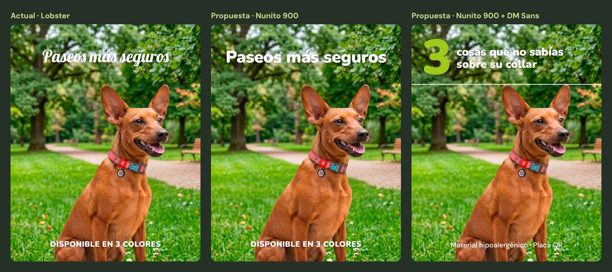

- Por qué: Nunito es redondeada y amable como la marca; con peso 900 tiene fuerza para leerse sobre fotos. DM Sans es limpia y neutra para lo chico. Con las dos, redes y web hablan igual.
- Ya no se usan Lobster ni Montserrat, que eran las fuentes de los posts anteriores.
- Títulos en minúscula, con mayúscula solo al principio. Las mayúsculas sostenidas quedan para líneas cortas, como «DISPONIBLE EN 3 COLORES».
- Interletrado levemente cerrado en títulos grandes (−0,5 px).

---

## 3. Elementos fijos

Todos estos elementos están listos en **`marca/elementos/`** (SVG vectorial y PNG), con un catálogo visual en `marca/elementos/catalogo.png`. Se usan siempre esos archivos; no se redibujan a mano.

**Isotipo (la «S»)**
- Blanco sobre foto o sobre verde; verde sobre blanco.
- Ancho de 90 a 110 px. Siempre con aire alrededor; no se deforma ni se le agregan sombras.
- Posición según estilo: abajo a la derecha (producto héroe, ficha), arriba al centro (pregunta enmarcada) o en pestaña verde arriba a la izquierda (estilo 2b).

**Sticker «Deslizá»**
- Diseño: el texto en arco a la izquierda y la mano con la flecha de deslizar (el de los posts anteriores de la marca, redibujado en vector).
- Va en la primera slide de **todo** carrusel, abajo a la derecha, de 150 a 170 px.
- Blanco sobre foto; verde sobre blanco; blanco sobre verde.
- Se escribe **DESLIZÁ**, con tilde (voseo, como el resto de la marca). Los posts anteriores dicen «DESLIZA».
- Variante puente: un círculo partido entre la slide 1 y la 2, para que al deslizar continúe. Se usó en el post del collar.

**Sombra del texto sobre foto:** `0 4px 18px rgba(0,0,0,.35)`. Suave, solo para que se lea. Nunca contorno duro.

**Márgenes de seguridad**
- 70 px a los lados: la grilla del perfil recorta las portadas 4:5 a 3:4.
- 90 px arriba y abajo.

---

## 4. Los estilos

### Estilo 1 · Título con profundidad
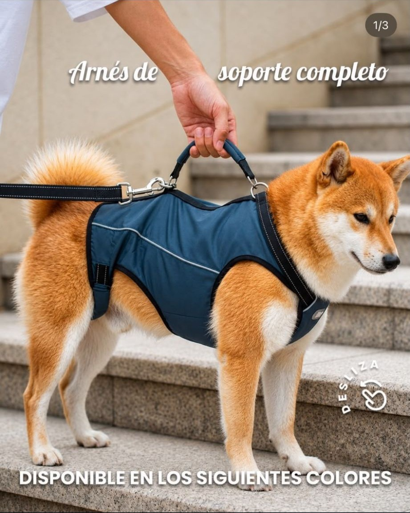

- **Qué es:** foto real de uso con el título en Nunito 900 blanco que **pasa por detrás** de un elemento de la foto (una mano, una oreja, la cabeza del perro). Es el efecto que más se destaca.
- **Título:** Nunito 900 blanco, 88–96 px, una línea, centrado entre y 140 y 240.
- **Línea inferior (opcional):** Nunito 900 en mayúsculas, blanco, 42–46 px, a lo ancho, cerca de y 1250. Ejemplo: «DISPONIBLE EN 3 COLORES».
- **Cómo se hace:** se recorta el elemento que va adelante (mano, cabeza, correa) y se coloca encima del texto. Necesita una foto con algo que cruce la zona del título. En el Studio: plantilla «Portada · título con profundidad», con la foto y el recorte (PNG sin fondo del mismo tamaño; se saca con rembg, modelo `isnet-general-use`). La altura del título se ajusta hasta que solo algo fino pase por delante.
- **Regla de oro: el título siempre se lee entero.** Por delante pasa algo fino (una correa, un dedo, la punta de una oreja), nunca la cabeza ni algo que tape una palabra. Si tapa, se sube o se baja el título.
- **Ejemplo:** `posts/2026-11-pechera-y-correa/`.

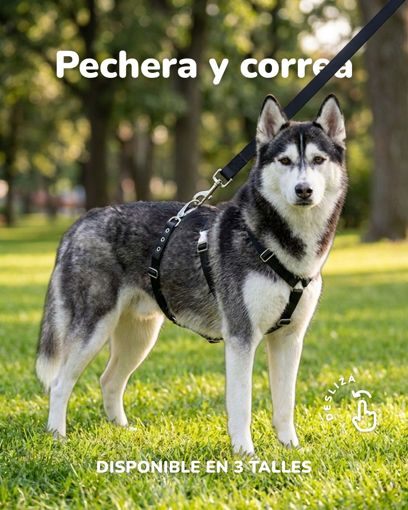
- **Cuándo:** lanzamiento o destaque de un producto con foto de uso.

### Estilo 1b · Título verde
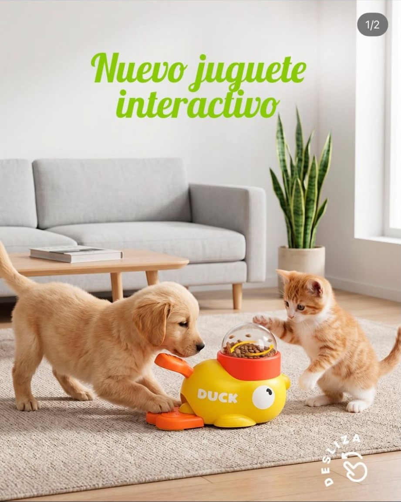

- **Qué es:** foto real con fondo claro y ordenado, y título en Nunito 900 verde arriba.
- **Título:** Nunito 900 `#9ECA1B`, 96–110 px, 1 o 2 líneas, centrado.
- **Regla:** el verde solo se usa si el fondo de esa zona es claro y limpio, como una pared blanca. Si no, el título va en blanco con sombra.
- **Cuándo:** novedades y productos nuevos.

### Estilo 2 · Número grande (listas)
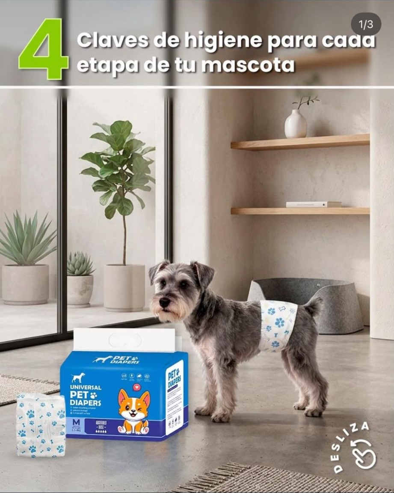 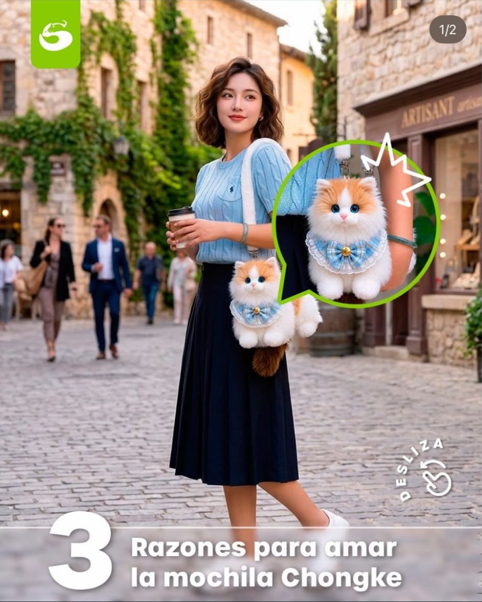

- **Qué es:** portada de carrusel tipo lista: «3 cosas que no sabías sobre…», «4 claves de…», «3 razones para…».
- **Número:** Nunito 900, 240–280 px, verde `#9ECA1B` (o blanco si la foto es verdosa), con sombra suave.
- **Título:** Nunito 900, blanco, 60–66 px, 2 líneas, alineado a la izquierda al lado del número.
- **Línea:** blanca, 4 px, de borde a borde, separando el bloque de texto de la foto.
- **Dos variantes:**
  - **Arriba (2):** número y título arriba; la línea queda debajo.
  - **Abajo (2b):** número y título abajo, sobre una banda esmerilada (desenfoque de 20 px + blanco al 12 %); la línea queda arriba de la banda. En esta variante va la pestaña verde con el isotipo arriba a la izquierda.
- **Slides interiores:** una idea por slide, con el mismo número en chico y el mismo estilo.

### Estilo 3 · Pregunta enmarcada
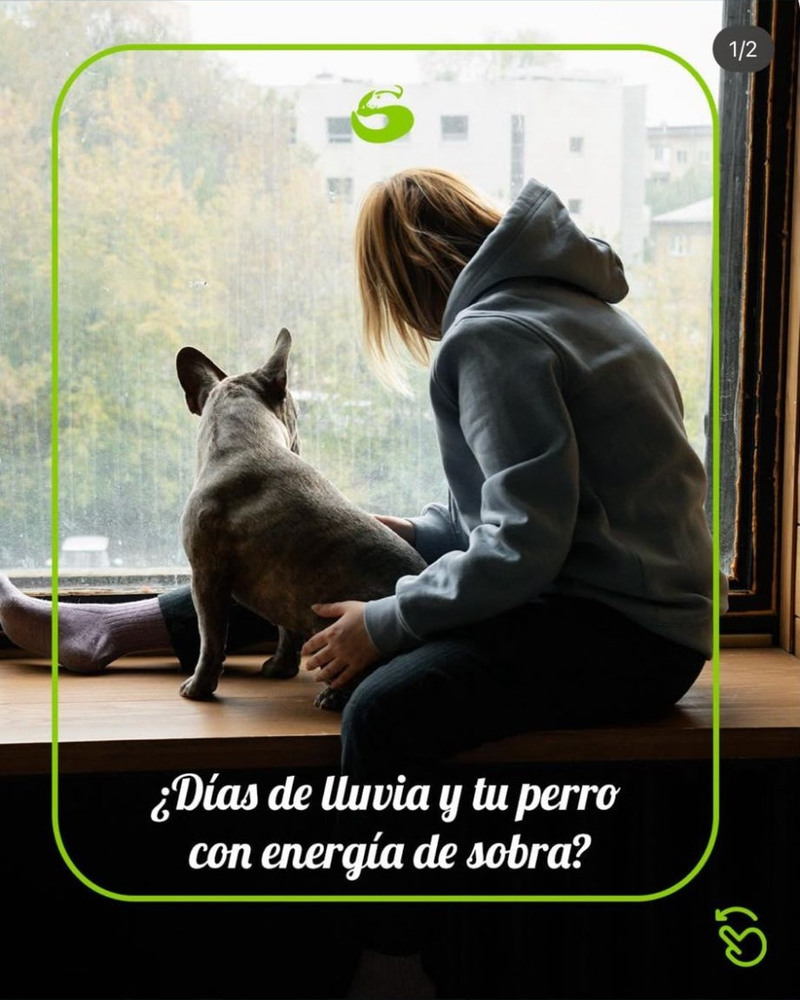

- **Qué es:** foto real emotiva, con un marco verde redondeado y una pregunta que plantea un problema. La slide 2 muestra la solución (el producto).
- **Marco:** trazo `#9ECA1B` de 6 px, radio de 56 px, a 72 px de los bordes (más abajo deja lugar al sticker).
- **Isotipo:** verde, arriba al centro, dentro del marco.
- **Pregunta:** Nunito 900 blanco, 64–70 px, 2 líneas, abajo dentro del marco, sobre un degradado oscuro de la foto.
- **Sticker «Deslizá»:** verde, abajo a la derecha, fuera del marco.

### Estilo 4 · Producto héroe
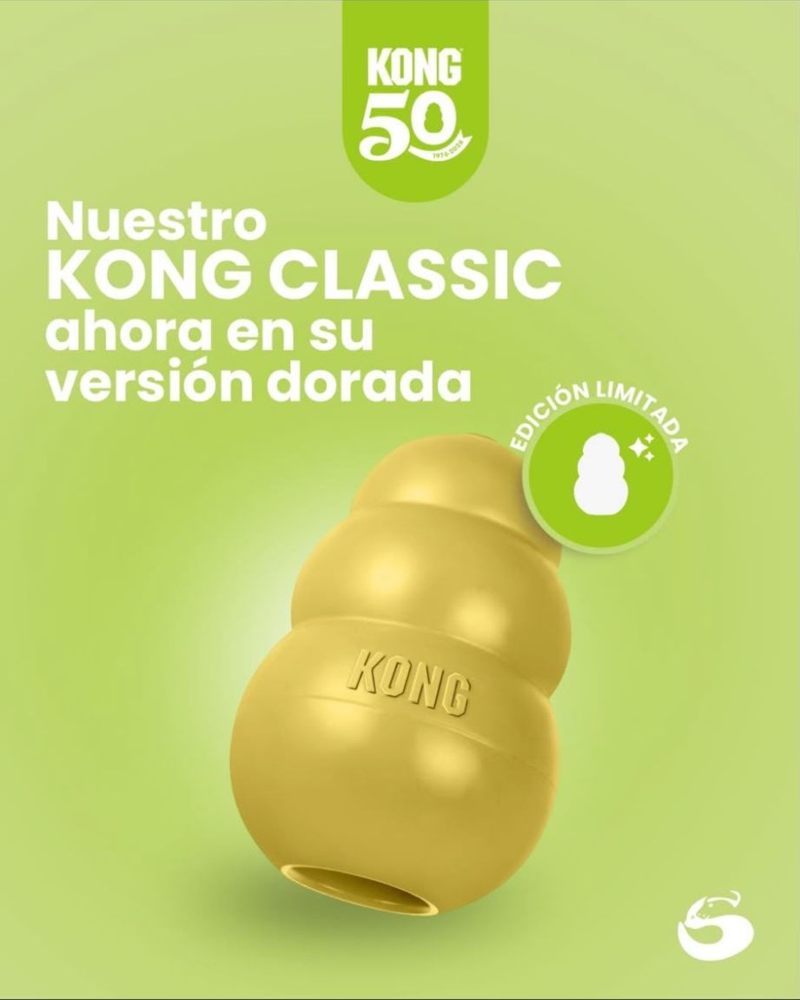

- **Qué es:** el producto solo, con calidad de estudio, sobre verde o blanco. Profesional y limpio. Se usa **cada tanto**: aproximadamente 1 de cada 6 portadas.
- **Fondo:** verde (degradado radial de `#CADC8A` en el centro a `#9ECA1B` en los bordes) o blanco.
- **Texto:** Nunito 900, alineado a la izquierda en x 70, arriba. Jerarquía:
  - línea chica de 60–66 px («Nuestro», «Nuevo»);
  - nombre del producto de 88–96 px, en mayúsculas;
  - bajada de 66–72 px.
- **Color del texto:** blanco sobre verde; `#253027` sobre blanco.
- **Pestaña superior (opcional):** con el logo de la marca del producto (KONG, WAUDOG, Brit…).
- **Sello circular (opcional):** «Edición limitada», «Nuevo». Verde con borde blanco y texto curvo.
- **Isotipo:** abajo a la derecha.

### Estilo 5 · Foto limpia
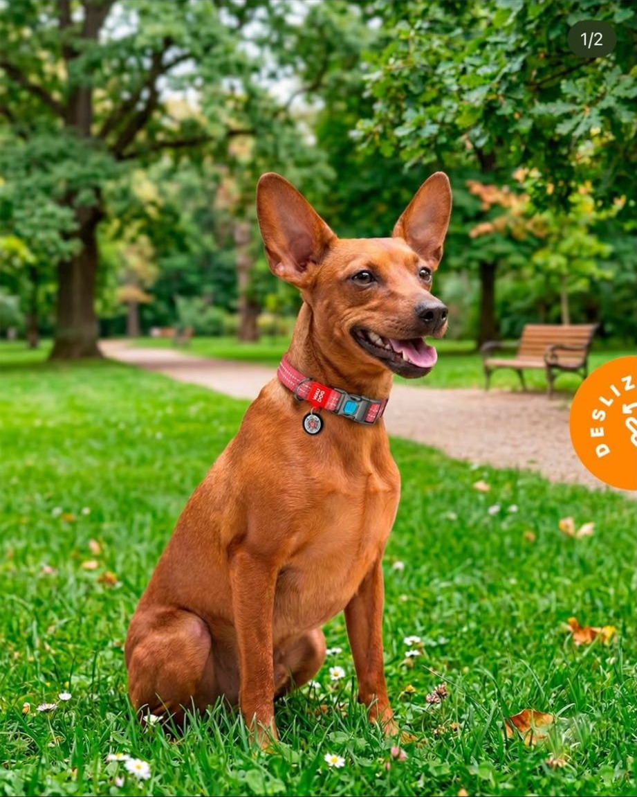

- **Qué es:** foto real muy buena, sin texto. Solo lleva el sticker «Deslizá». La foto habla sola y el texto queda para el posteo.
- **Cuándo:** primera slide de un carrusel de producto cuando la foto es muy fuerte.

### Estilo 6 · Ficha de producto con callouts
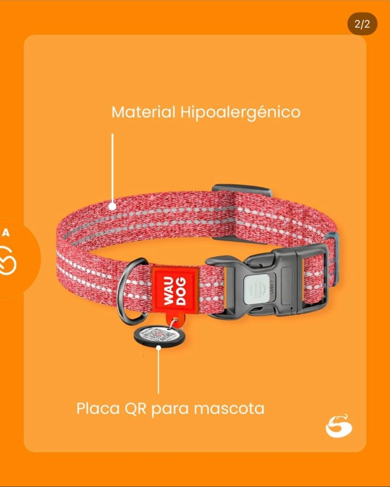

- **Qué es:** el producto recortado, con líneas que señalan sus características.
- **Fondo:** verde o blanco, nunca naranja. En el post del collar se usó naranja: desde ahora va en colores de marca.
- **Líneas:** de 3 px, blancas sobre verde o `#253027` sobre blanco, con un punto de 14 px en el extremo que toca el producto.
- **Textos:** DM Sans 500, 38–42 px. Máximo 3 callouts.
- **Isotipo:** abajo a la derecha.

### Estilo 7 · Producto sobre fondo claro
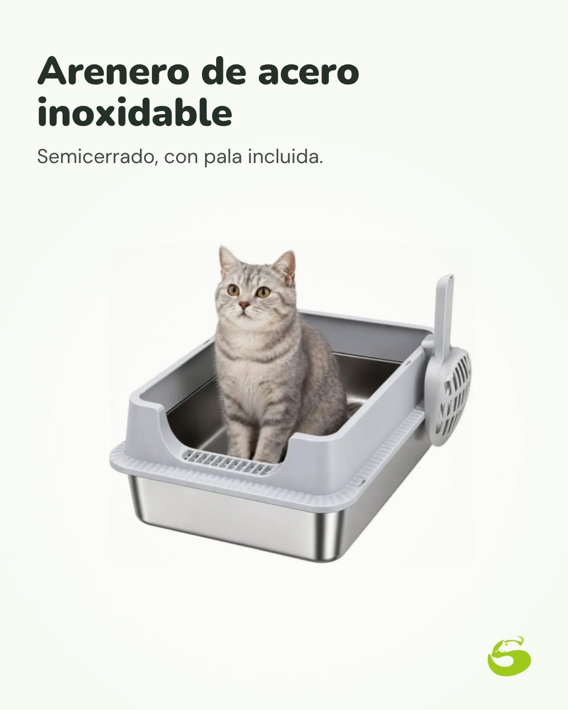

- **Qué es:** la foto de catálogo del producto, grande, sobre el fondo claro de la marca. Limpio y directo, como hacen Petz y otras tiendas grandes. Varía la grilla entre tantas fotos.
- **Fondo:** superficie `#F8FAF4` con un brillo blanco en el centro. La foto del producto tiene que tener fondo blanco (la de la web sirve): se «multiplica» con el fondo y el blanco desaparece.
- **Texto:** arriba a la izquierda. Nombre del producto en Nunito 900 `#253027`, 80–86 px; bajada opcional en DM Sans 38 px gris oscuro (qué es o para quién es, sin inventar).
- **Abajo:** isotipo verde a la derecha (o el sticker «Deslizá» si es carrusel). Nada más: sin llamados a la venta.
- **Sin precio.** Nunca.
- **Cuándo:** novedades, reposiciones y productos puntuales. Puede ser portada o slide interior de un carrusel de producto.

### Estilo 8 · Aviso solo texto
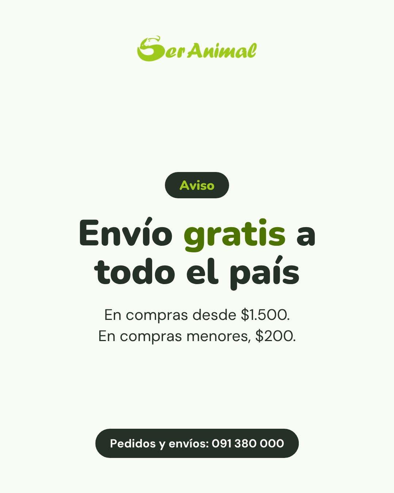 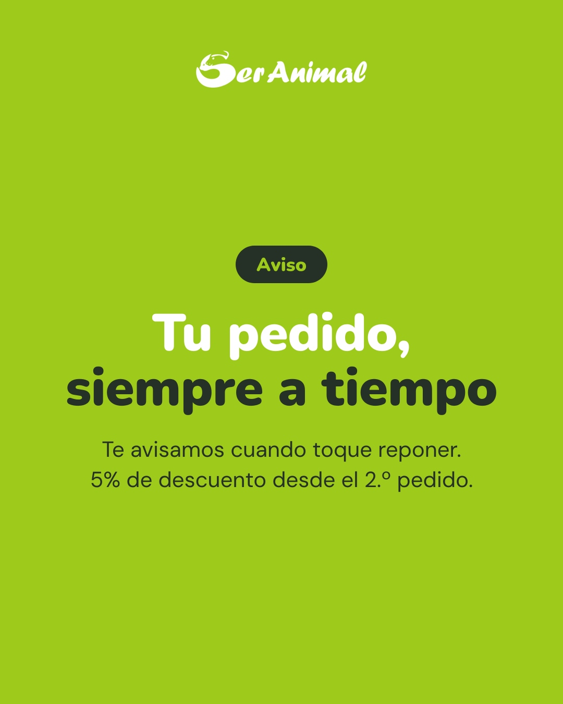

- **Qué es:** un aviso de la tienda, solo con texto: envíos, pedido programado, horarios, feriados, cambios. Se lee de un vistazo.
- **Fondo:** blanco (superficie) o verde Ser Animal, alternándolos.
- **Arriba:** logo completo, centrado (verde sobre blanco; blanco sobre verde).
- **Etiqueta:** pastilla «Aviso» (`marca/elementos/etiqueta-aviso`); para productos nuevos existe «Novedad».
- **Título:** Nunito 900, 90–100 px, centrado. Las 1 a 3 palabras clave van destacadas: verde hoja `#4C7300` sobre blanco; `#253027` sobre verde.
- **Texto:** DM Sans 42 px, centrado, con los textos fijos de la marca cuando corresponda.
- **Abajo:** nada. El dato de contacto, si hace falta, va en el texto del posteo.
- **Cuándo:** un post suelto, sin carrusel. Como máximo uno cada 9 portadas.

---

## 4b. Estilos editoriales (referencia: Petz)

Inspirados en el feed de Petz (`lineamientos/referencias/`), pero con la marca de Ser Animal: verde, Nunito 900, DM Sans y los personajes de especie. Le dan al feed un aire de revista: mucho aire, globos y tarjetas blancas, palabras subrayadas y etiquetas de serie. Elementos nuevos: `etiqueta-<pilar>`, `flecha-circulo-*`, `flecha-linea-*` y `personaje-<especie>`.

**Etiquetas de serie.** Cada pilar tiene su pastilla (`etiqueta-sabias-que`, `etiqueta-cuidalo-mejor`, `etiqueta-familia`), como «Guia de Raças» o «Assinatura Petz». Va arriba a la izquierda o arriba del título. Así el seguidor reconoce la serie de un vistazo. **Los posts de producto no llevan etiqueta:** nunca se pone «En la tienda» en las imágenes (solo «Novedad» si el producto es nuevo).

### Estilo 9 · Pregunta en globos
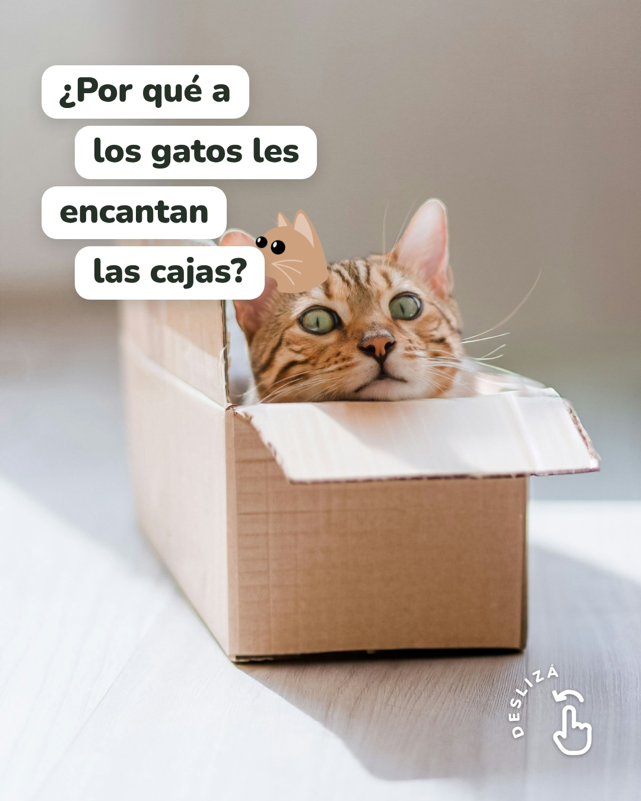

- **Qué es:** foto real con la pregunta en globos blancos, un renglón por globo, escalonados. El personaje de la especie se asoma detrás del último globo.
- **Globos:** fondo blanco, radio 26 px, sombra suave; Nunito 900 `#253027`, 50–58 px. De 2 a 4 renglones de hasta 16 letras.
- **Dónde:** arriba a la izquierda, sobre una zona tranquila de la foto. Nunca sobre la cara del animal.
- **Sticker «Deslizá»:** blanco, abajo a la derecha.

### Estilo 10 · Foto con panel
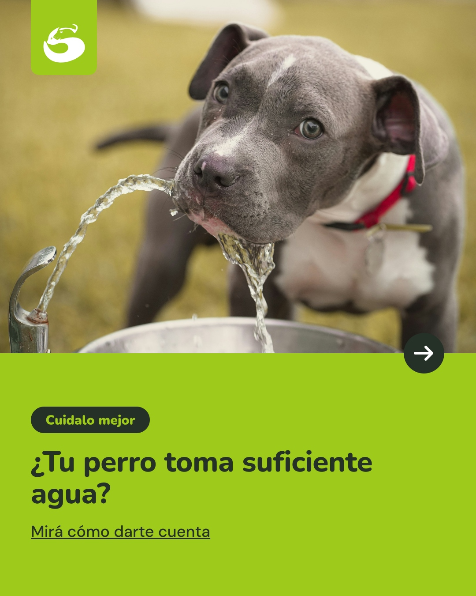

- **Qué es:** foto arriba (800 px) y un panel verde o blanco abajo con etiqueta, título y una bajada subrayada que invita a seguir («Mirá cómo darte cuenta»).
- **Título:** Nunito 900 `#253027`, 60–66 px, a la izquierda.
- **Flecha:** `flecha-circulo-oscuro` (panel verde) o `-verde` (panel blanco), sobre el borde entre foto y panel, a la derecha. En este estilo la flecha cumple la función del «Deslizá».
- **Pestaña con isotipo** arriba a la izquierda, sobre la foto.

### Estilo 11 · Texto editorial
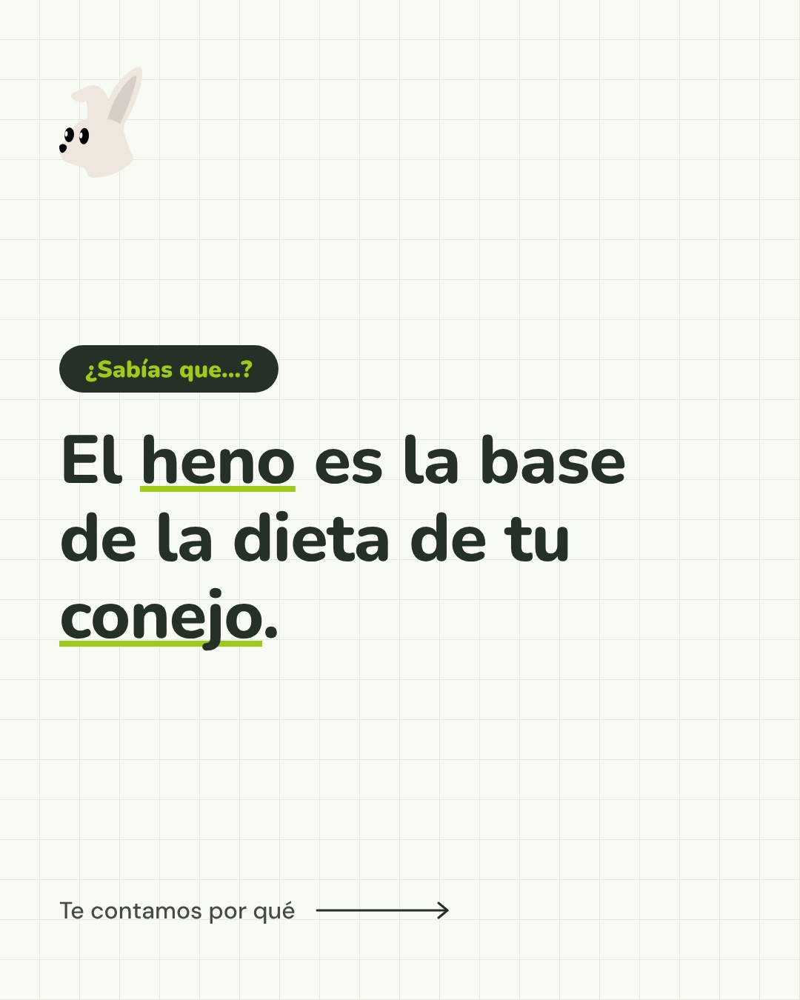

- **Qué es:** solo texto, grande y alineado a la izquierda, sobre blanco o verde. Una idea fuerte o la pregunta que el carrusel responde.
- **Título:** Nunito 900, 80–92 px. Las 2 a 5 palabras clave van **subrayadas**: línea verde de 8 px sobre blanco; blanca sobre verde.
- **Arriba a la izquierda:** el personaje de la especie (o el isotipo) y, debajo, la etiqueta de serie.
- **Abajo:** una línea corta en DM Sans («Te contamos por qué») y el «Deslizá» si es carrusel.

### Estilo 12 · Foto enmarcada
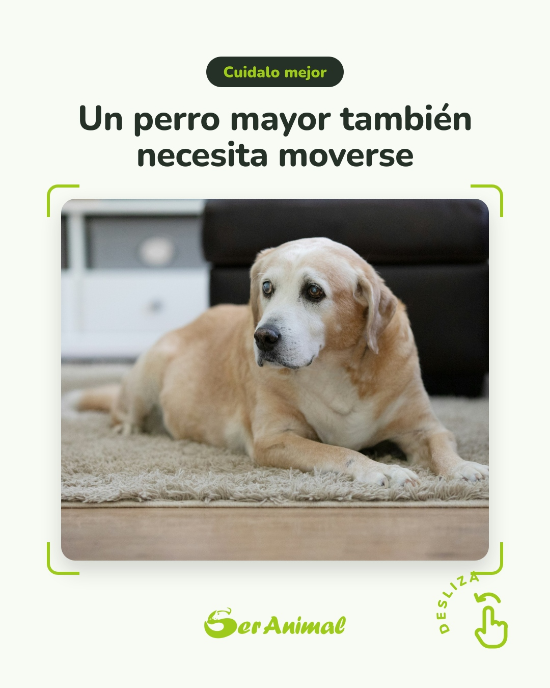

- **Qué es:** fondo blanco o verde, título centrado arriba, la foto en una tarjeta redondeada con cuatro esquinas verdes alrededor, y el logo abajo.
- **Título:** Nunito 900, 60–68 px, 1 o 2 renglones, con la etiqueta de serie encima.
- **Cuándo:** consejos y temas tranquilos. Funciona muy bien con fotos de interiores.

### Estilo 13 · Retrato con nombre
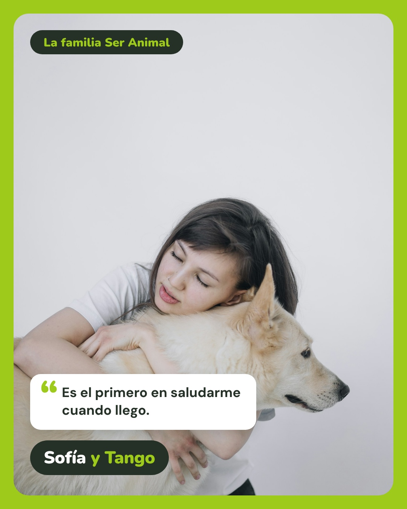

- **Qué es:** la foto de un cliente con su mascota, a sangre, con una línea blanca fina por dentro (a 44 px del borde, radio 40). Es la cara del pilar «La familia Ser Animal».
- **Etiqueta:** «La familia Ser Animal», apoyada sobre la línea de arriba, a la izquierda.
- **Nombres:** pastilla en dos tonos apoyada sobre la línea de abajo, a la derecha: el nombre de la persona en blanco y el de la mascota en verde («Sofía *y Oakley*»).
- **Cita:** globo blanco con comillas verdes, DM Sans 700, máximo 3 renglones, con el personaje de la especie asomándose detrás.
- **Ya no se usa** el marco verde grueso de la primera versión.
- **Siempre real:** foto, nombres y cita del cliente, con su permiso. Nunca se inventan.

### Estilos 14 y 15 · Título editorial sobre foto (arriba o abajo)
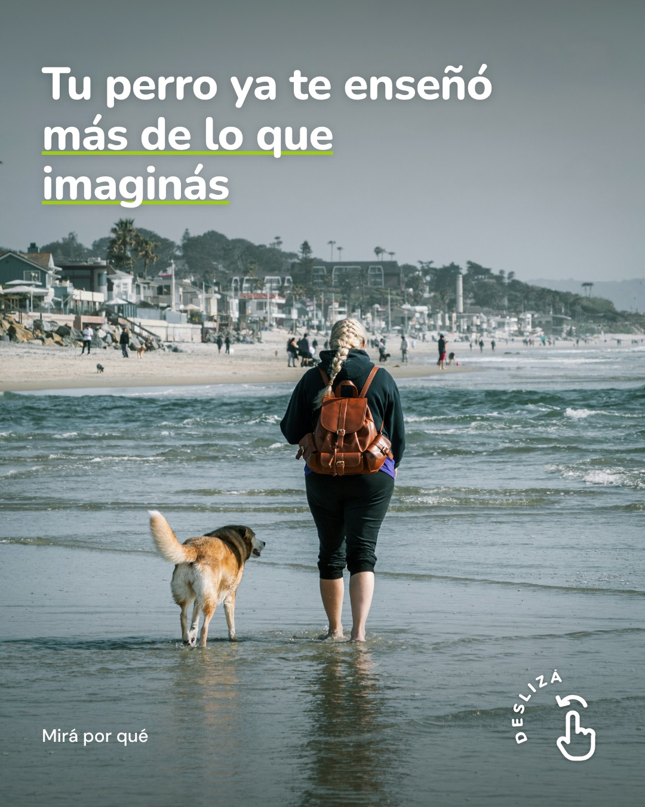 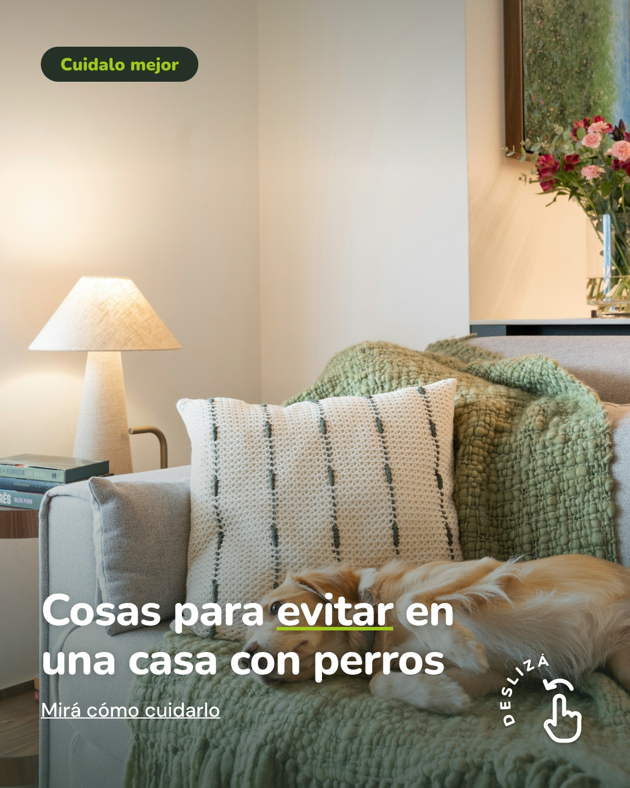

- **Qué es:** el recurso que más usa Petz (ver `referencias/petz-analisis.md`). Foto real, mejor con una persona y su mascota, y el título en blanco a la izquierda, sin sombra fuerte: un velo oscuro suave detrás lo hace legible.
- **Título:** Nunito 800 blanco, 64–76 px. Las palabras clave entre asteriscos se subrayan en verde.
- **Arriba (14):** título arriba; abajo, una línea corta («Mirá por qué»).
- **Abajo (15):** título abajo con la bajada subrayada; la etiqueta de serie arriba a la izquierda. Ideal para la serie «Guía de razas».
- **Sticker «Deslizá»:** blanco, abajo a la derecha.

### Estilo 16 · Cita sobre foto
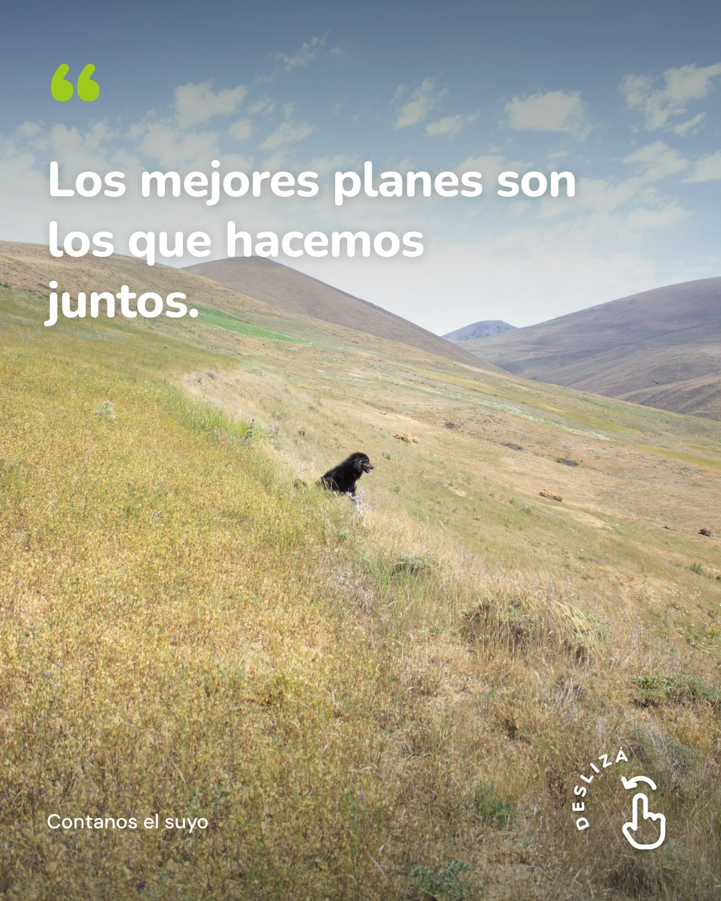

- **Qué es:** una frase emotiva arriba, con comillas verdes grandes, sobre una foto con cielo o fondo despejado; una línea chica abajo.
- **Regla:** si la cita es de un cliente, real y con permiso. Si no, es una frase de la marca y no se le atribuye a nadie.

### Estilo 17 · Mosaico de palabras
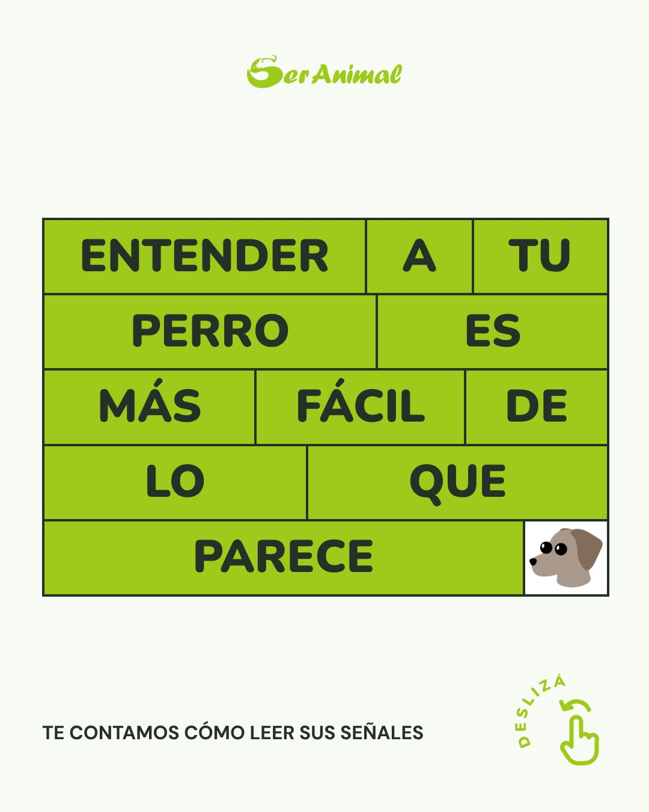

- **Qué es:** cada palabra de la frase en un bloque verde con borde oscuro, en grilla; en un bloque blanco, el personaje de la especie. Logo arriba y un remate en mayúsculas abajo.
- **Frase:** de 6 a 12 palabras. Uno cada tanto: llama mucho la atención.

**Toques Petz en todos los editoriales:** títulos en Nunito 800 (más livianos que el 900) y papel cuadriculado suave en el texto editorial sobre blanco.

**Una sola indicación para deslizar.** Si la slide lleva el sticker «Deslizá», no se suma ninguna flecha. La flecha en círculo solo va en «foto con panel», en lugar del sticker.

### Estilo 18 · Ficha de producto (segunda slide)
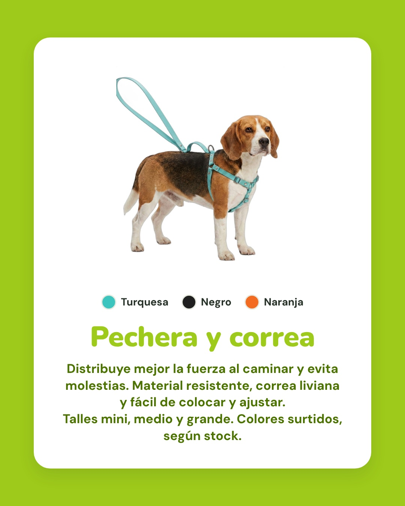

- **Qué es:** la slide con la información, después de una portada linda. Tiene que verse como un catálogo lindo, no como un folleto: mucho aire y poco texto.
- **Fondo:** degradé suave de verde claro `#CADC8A` en el centro a verde `#9ECA1B` en los bordes. Tarjeta blanca amplia (a 80 px de los bordes, radio 56) con sombra suave.
- **Producto:** solo, sin perro, grande y recortado sobre blanco. Si viene en varios colores, los colores juntos y superpuestos, como una familia.
- **Arriba:** nada, o «Novedad» si el producto es nuevo. Nunca «En la tienda».
- **Colores:** muestras chicas con el nombre, en DM Sans 500.
- **Nombre:** Nunito 900 `#253027`, centrado.
- **Descripción:** una sola línea corta en DM Sans 500 gris oscuro.
- **Datos clave:** de 2 a 4 pastillas chicas (talles, material, «colores según stock»), en verde hoja sobre superficie con borde verde claro.
- **Siempre:** datos de la ficha de la tienda online, nunca precio.

---

## 5. Estructura de carrusel (por defecto)

1. **Slide 1, imagen real:** estilos 1, 1b, 2, 3, 5, 9, 10, 12, 13, 14, 15 o 16 (o 7 si el post es de un producto puntual; u 11 para una idea fuerte).
2. **Slides siguientes, producto con colores de Ser Animal:** estilos 4, 6 o 7, o más fotos de uso. Se alterna verde y blanco entre slides.
3. **Última slide (opcional), cierre:** logo, una pregunta para comentar y una frase corta. Sin teléfono ni «pedilo»: eso va en el texto del posteo.

Los avisos (estilo 8) van como post de una sola imagen.

**Carrusel de producto (el preferido de la marca):** 2 slides.
1. **Portada linda:** foto real del producto en uso (un perro con la pechera puesta, una mano con el juguete), sola, con título editorial (estilo 14) o con título con profundidad (estilo 1) si el sujeto lo permite sin tapar letras, y una línea abajo («Disponible en 3 talles»).
2. **Ficha de producto (estilo 18):** foto sobre blanco, colores, nombre y descripción.

**Qué productos mostrar:** siempre productos lindos de la tienda online, que se vean bien en foto (pecheras, correas, camas, juguetes, comederos de diseño). Nada de productos feos o poco vistosos. Los datos se sacan de la ficha de seranimal.com.uy. Pensar ideas creativas para la portada: la foto tiene que dar ganas de tenerlo.

Largo: de 2 a 5 slides.

---

## 6. Animaciones

Los mismos estilos, en movimiento, para Reels o posts en video:

- **Texto:** el título sube y aparece palabra por palabra; el número entra con rebote.
- **Estilo 1:** el título aparece por detrás de la mano o del perro.
- **Estilo 3:** el marco verde se dibuja alrededor de la foto.
- **Estilo 4:** el producto entra con escala suave y el sello gira.
- **Estilo 6:** las líneas de los callouts se dibujan hacia el producto.
- **Transiciones:** círculo o barrido verde, como en el post animado de marca.

Reglas:
- Duración de 8 a 17 s.
- El título se lee en el primer segundo y medio.
- Formato 4:5 para el feed o 9:16 para Reels e historias.
- La música se agrega desde Instagram.

---

## 7. Ritmo de la grilla

Lo que se ve en el perfil es la primera slide de cada post:

- **Base del feed:** portadas con foto real (estilos 1, 1b, 2, 3 y 5).
- **Producto héroe (estilo 4):** como máximo una por fila de 3 y nunca dos seguidas.
- **Editoriales (estilos 9 a 17):** son la base nueva del feed junto con las fotos. Mezclalos: en una fila de 3, que no se repita el estilo.
- **Fondo claro (estilos 7, 8 y 11):** suman variedad, pero nunca dos seguidas y como máximo 3 de cada 9 portadas. La foto real sigue siendo la base.
- **Estilos de texto:** no repetir el mismo estilo de portada dos veces seguidas.
- **Fotos de la misma fila:** que tengan una luz parecida (cálida y natural).

---

## 8. Imágenes generadas con IA

- **Aspecto:** fotográfico. Luz natural, casas y calles creíbles, poses espontáneas y mascotas con proporciones reales.
- **Revisar siempre:** patas, manos y dedos; ojos; correas y hebillas; que no aparezca texto inventado en la imagen.
- **Producto:** se sube la foto real como referencia y se verifica que coincida antes de usarla.
- **Etiqueta:** activar «Contenido de IA» al publicar.

---

## 9. Checklist antes de publicar

- [ ] La portada es una imagen real o realista.
- [ ] Las imágenes se ven nítidas al 100 % (fotos y textos), sin pixelado ni compresión.
- [ ] Los fondos son solo foto, verde o blanco.
- [ ] No aparece ningún precio de producto, ni en la imagen ni en el posteo.
- [ ] Las fuentes son solo Nunito y DM Sans.
- [ ] El texto no tapa caras y respeta los márgenes de seguridad.
- [ ] El sticker «DESLIZÁ» está en la primera slide del carrusel.
- [ ] El isotipo está bien usado: sin deformar, sin sombras y con aire.
- [ ] El texto del posteo tiene voseo y no inventa precios ni datos.
- [ ] La portada no repite el estilo de la anterior en la grilla.
